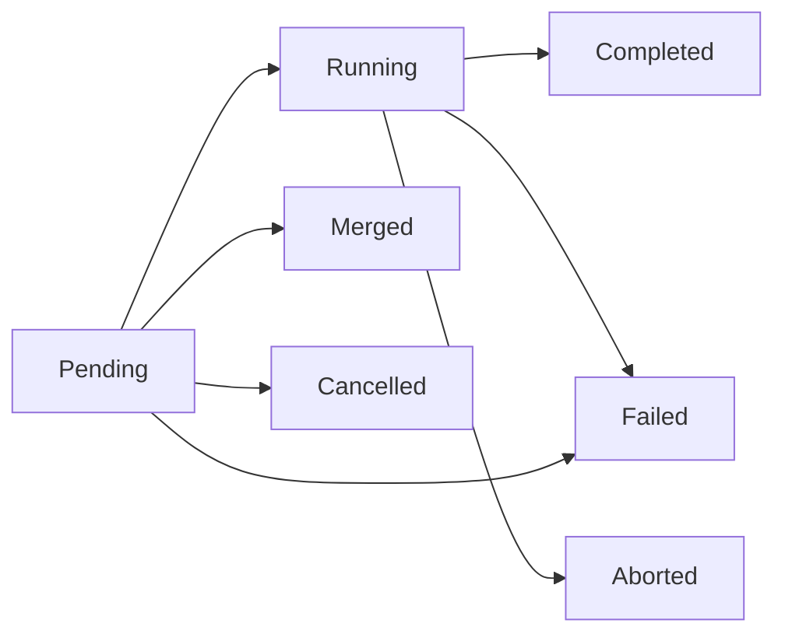

A **job** is one execution; an **operation** is one action requested on a
service. Use the IDs from `svctl status` to follow what is happening. A
service restart creates a new job, so its job ID also distinguishes its output
from the previous run.

```sh
svctl status jellyfin
svctl operation-status <operation-id>
svctl job list --state running
svctl job status <job-id>
```

`job list` and `job status` here are for submitted jobs. For service-run
history, follow the job ID into [logs and
events](~peios/services-and-jobs/output-and-logging). Live status is
short-lived; eventd is where to look after an ID expires.

## Run a one-off job

Use `job submit` when you want one supervised execution under your own
identity. For example, if `/usr/bin/backup` is installed:

```sh
svctl job submit --description "nightly backup" --timeout 3600 -- /usr/bin/backup --full
```

Keep the returned ID, then query or wait for it:

```sh
svctl job status <job-id>
svctl job wait <job-id>
```

To end the whole job, use `svctl job stop <job-id>`. `job signal` sends a
signal only to its main process and is not a substitute for stopping its
cgroup. Check the final state **and** cause: a job that handles a requested
stop and exits successfully is `Completed` with cause `explicit_stop`.

A submitted job remains queryable for 60 seconds after it ends. After that,
use its GUID in eventd. See [job command options and
permissions](~peios/services-and-jobs/controlling-services#job-commands)
before passing descriptors, changing the job descriptor, or attaching live
output.

## How they surface

You meet jobs and operations in four places:

- **`status`** — `current_job` and `current_operation` give the GUIDs of the
  service's active execution and active action (or `null`).
- **`operation-status <id>`** — polls one operation to a terminal state; a
  `--wait` lifecycle command does this for you under the hood.
- **`job list` / `job status <id>` ** — the submitted jobs you can query, and
  one job's view.
- **[eventd](~kernel/internals/kacs/auditing/overview)** — the durable history. Every job and
  operation lifecycle transition lands there as a structured event, which is
  how you reconstruct what happened after the objects themselves are gone from
  peinit's memory.

## Jobs: what actually ran

Every time peinit forks a process — a service's main binary, a [pre- or
post-hook](~peios/services-and-jobs/execution-environment), a [health
check](~peios/services-and-jobs/supervision), or a [submitted
job](#submitted-jobs) — that single execution is a **job**, with its own GUID
and exit result. If a service is the *what*, a job is *what actually ran*. A
restart does not reuse a job; it creates a **new** one. The service always
tracks its *current* job GUID, and a `status` query reports it.

Jobs come in five types:

| Type | Created for |
|---|---|
| `ServiceMain` | A service's main process. |
| `PreExecHook` | One `ExecStartPre` command. |
| `PostExecHook` | One `ExecStartPost` command. |
| `HealthCheck` | One health-check run. |
| `Submitted` | A program [submitted](#submitted-jobs) over the jobs socket. |

Their lifecycle is simpler than a service's, because a job only tracks a
process — not policy:

| State | Meaning |
|---|---|
| `Created` | The job object exists but the process is not forked yet (pre-hooks can be running). |
| `Running` | The process is alive. |
| `Completed` | The process exited successfully. |
| `Failed` | The process failed — or peinit classified the job failed before fork (a parent-side setup error). |
| `Abandoned` | The process survived SIGKILL (D-state). |

A job record carries the things you would want for forensics: the resolved
identity and a token summary, the image path and arguments,
created/started/ended timestamps, the exit code or signal, the cgroup, the
[failure cause](~peios/services-and-jobs/the-service-lifecycle), and the
`operation_id` that created it (`null` for submitted jobs). The clean division
of ownership is: the **service** owns policy (restart, dependencies, health
schedule, current state); the **job** owns the execution facts (PID, exit,
timestamps, identity, cgroup, log correlation).

### Retention and log correlation

For service executions, peinit keeps only *active* job records in memory. When
a job reaches a terminal state it **emits a structured event** (through KMES)
carrying the full record, then drops the job. Submitted jobs retain a terminal
view for 60 seconds, as described below; peinit keeps **no durable** job
history — [eventd](~kernel/internals/kacs/auditing/overview) is the historian, consuming those
events from the kernel ring buffer. The lifecycle events are
`peinit.job.created`, `peinit.job.started`, and `peinit.job.ended`; a
submitted job also emits `peinit.job.status.reported` as its progress changes.
`peinit.job.created` and `peinit.job.status.reported` are *verbose* events,
off unless the event emission policy (`Machine\Generic\Events`, PGSS §6.9)
turns them on.

Separately, captured job `stdout` /`stderr` is [forwarded to
eventd](~peios/services-and-jobs/output-and-logging) tagged with the job's
GUID. A service with `TTYPath` writes to its terminal instead; see the
[terminal-attached service
exception](~peios/services-and-jobs/output-and-logging#capturing-output). The
GUID lets a query like "show me the logs for job X" distinguish that
execution's records from the run before or after it.

## Operations: what was requested

An **operation** is a first-class object representing a *requested
state-machine action* on a service. Rather than letting [control
commands](~peios/services-and-jobs/controlling-services) mutate state
directly, peinit turns each one into an operation that is validated, queued,
and executed by its event loop. This is what gives concurrent callers — admin
tools, automated triggers, dependency propagation — explicit, observable
conflict resolution instead of races.

There are five operation types — `Start`, `Stop`, `Restart`, `Reload`,
`Reset` — and each carries a **source** recording *why* peinit created it:

| Source | Created by |
|---|---|
| `Admin` | A control client. |
| `Boot` | The Phase 2 boot lifecycle. |
| `Shutdown` | The shutdown lifecycle. |
| `DependencyPropagation` | A start pulling in a [dependency](~peios/services-and-jobs/dependencies). |
| `RestartPolicy` | An automatic [restart](~peios/services-and-jobs/supervision). |
| `Timer` | A [timer](~peios/services-and-jobs/triggers-and-timers) firing. |
| `BindsToRecovery` | A bound target returning to Active. |
| `BindsToPropagation` | A bound target stopping. |
| `ConflictResolution` | A `Conflicts` eviction. |
| `OnFailure` | A failed service's fallback handler. |

The source is why a `status` showing
`current_operation.source: "restart_policy"` tells you the service is being
auto-restarted, while `"admin"` tells you a person asked.

### Operation lifecycle



| State | Meaning |
|---|---|
| `Pending` | Validated and queued, waiting on a precondition (for example a prior stop to finish). |
| `Running` | Executing — the service is transitioning. |
| `Completed` | Achieved its goal (start reached Active/Completed; stop reached Inactive/Failed). |
| `Failed` | Did not achieve its goal — including timing out while still Pending. |
| `Merged` | Folded into an identical operation already in flight (records the survivor's GUID). |
| `Cancelled` | Terminated while still Pending — never ran. |
| `Aborted` | Terminated while Running — interrupted in progress. |

`Cancelled` and `Aborted` are the same idea at two points: canceled never ran,
aborted was running. The *reason* (admin action, supersession) is a property
of the event, not the state.

### Conflict resolution and merging

When a command arrives for a service that already has an operation in flight,
peinit resolves the collision deterministically — the same logic the [command
× state matrix](~peios/services-and-jobs/controlling-services) summarizes:

- **Same type** (start over start, stop over stop, reload over reload) →
  **merge**. The new caller transparently receives the existing operation's
  GUID; from their side, their request is in progress.
- **Stop wins over start.** An explicit stop cancels a pending start or aborts
  a running one. The admin said stop.
- **Later supersedes earlier**, and a start while a stop is in flight is
  **queued** to run after the stop.

### Timeout and retention

An operation inherits its target's timeout as its maximum lifetime —
`StartTimeout` for start/reload/reset, `StopTimeout` for stop, and the sum of
both legs for restart. Crucially, **the clock starts at operation creation,
including queue time** — from the caller's perspective they have been waiting
since they sent the command, so a long queue can time an operation out before
it even runs.

Operations are emitted as events (`peinit.operation.requested`, `.started`,
`.ended`, and `.merged`; one `.ended` covers completed, failed, canceled and
aborted, and says which) and terminal ones are dropped from memory after a
short grace (default 60 s — long enough for a polling client to read the
result). As with jobs, peinit keeps no operation history; eventd does.

## Submitted jobs

A **submitted job** is a program peinit runs once, under supervision, because
a process asked it to — not because a definition in the registry said so. Two
situations motivate it:

- A **task on a client's behalf.** `backupd` takes a request from a user, and
  wants the backup to run *as that user*, in its own cgroup, with a timeout,
  reporting progress, visible in `job list` — but supervised by peinit rather
  than by `backupd` itself.
- A **session.** A logon service (say, a web front-end) has authenticated a
  user and wants a long-lived per-logon process running as them, with a socket
  it can talk to, that it can stop when the session ends.

Both are the same mechanism: a **jobs socket** at
`/run/services/peinit/jobs.sock`, separate from the [control
socket](~peios/services-and-jobs/controlling-services). A submitter connects,
sends a job definition, and gets back the job's view and — while the job runs
— a handle to its process.

### Who can submit

**Being able to connect is the permission.** peinit performs no access check
of its own on a submission; the check is the one the kernel performs against
the socket file's security descriptor
when a process connects. The default descriptor gives SYSTEM and
Administrators full control and **Authenticated Users** the write right that
connecting requires — so out of the box, any logged-on principal can submit,
and an administrator narrows or widens that by changing the socket's
descriptor, not by configuring peinit.

What limits an over-eager submitter is a **quota**: at most
`MaxJobsPerSubmitter` live jobs per submitting SID (default 64; SYSTEM is
exempt). A submission that would exceed it is refused with `QUOTA_EXCEEDED`
and creates nothing. A job stops counting the moment it ends.

### What a job runs as

A job submitted by `svctl` runs as your process's own primary token. There is
no CLI identity switch. A service can submit with a token it is authorized to
convey; the kernel checks that authority, and a token below Impersonation
level is refused with `BAD_TOKEN`. A job needing Delegation must be submitted
through a connection already at that level; it cannot be raised later.

The view records both the **submitter** and the **identity** the job runs as,
plus its logon session. The [TRM identity-conveyance
reference](~peios/reference/peinit/jobs-and-operations/submission-and-progress-examples#what-a-job-runs-as)
describes attached tokens.

### The definition

Choose an absolute image path, its arguments and environment, a working
directory, and any timeout or readiness settings. A submitted job has no
restart policy, dependencies, health check, or trigger; use a service
definition if you need those.

Submission returns once the job is running or has failed to start, not when it
has finished or signaled readiness. Use `--wait` to wait for completion or
`job wait --for ready` for a job configured with notify readiness. An accepted
submission can still fail at exec, for example because its identity cannot
execute the image.

See [svctl job
options](~peios/services-and-jobs/controlling-services#job-commands) for the
CLI and the [submission
reference](~peios/reference/peinit/jobs-and-operations/submission-and-progress-examples#the-definition)
for complete fields and descriptor passing.

### Who can manage a job

Every job carries its own security descriptor from the moment it exists. By
default it is owned by the submitter and grants **`JOB_ALL_ACCESS`** to the
submitter, SYSTEM, and Administrators — and to nobody else. In particular the
**job identity gets nothing**: a process running as U cannot see or stop a job
that happens to run as U, unless the submitter's descriptor says so. A
submitter can supply its own descriptor (in SDDL) and peinit uses it exactly
as given — including a descriptor that locks the submitter out of its own job.

| Right | Grants |
|---|---|
| `JOB_QUERY` | Read the job view; wait on it; see it in `job list`. |
| `JOB_STOP` | Stop the job. |
| `JOB_SIGNAL` | Send a signal to the job's main process. |

These rights govern both the jobs socket's own commands (`status`, `wait`,
`stop`, `signal`) and the control socket's `job-status`, `job-list`,
`job-stop`. As with services, `job list` **filters** rather than denies: you
see the jobs you hold `JOB_QUERY` on, while a command naming an existing job
you cannot query returns `ACCESS_DENIED`. `UNKNOWN_JOB` means the ID is
unknown or already discarded.

### The job view

`svctl job status <id>` reports the job's state and cause, submitter and
execution identity, PID, readiness, exit code or signal, and timestamps. Its
status text and progress are reported by the program itself; an absent value
does not establish that it is stuck.

The [TRM job-view
reference](~peios/reference/peinit/jobs-and-operations/submission-and-progress-examples#the-job-view)
describes the progress message forms and update limits.

### Stopping, timeouts, and the end of a job

A job ends when its process exits, when its `timeout` elapses, when its
`readiness_timeout` elapses without `READY=1`, when someone stops it, or at
shutdown. A stop — whichever of those triggers it — is a service stop in
miniature: SIGTERM to the main process (skipped if the job already said
`STOPPING=1`), then after `stop_timeout` a SIGKILL of everything in the job's
cgroup, and if that survives, the job is `Abandoned` after the post-kill grace
with cause `process_unkillable`.

`cause` records why peinit ended a job, and is `null` when the process ended
of its own accord:

| Cause | Meaning |
|---|---|
| `parent_setup_failure` | peinit could not prepare the launch — no token, no cgroup, no fork. No process existed. |
| `pre_exec_failure` | Setup between fork and exec failed, or `execve` did. |
| `readiness_timeout` | A `notify` job never sent `READY=1` in time. |
| `timeout` | The job ran longer than `timeout`. |
| `explicit_stop` | A `stop` or `job stop` was issued. |
| `shutdown` | The system was shutting down. |
| `process_unkillable` | The process survived SIGKILL. |

State follows the exit, not the cause: a stopped job whose process handled
SIGTERM and exited `0` is **`Completed` with cause `explicit_stop` ** — peinit
asked, the process agreed, and both facts are recorded. One that died to the
signal is `Failed` with `exit_signal` set. A `signal` command is the raw
mechanism, by contrast: `SIGKILL` sent that way produces a `Failed` job with a
`null` cause, because peinit did not decide to end it.

A terminal job is **retained for 60 seconds** — long enough for a submitter
polling once a second to read the result — then dropped; after that its GUID
answers `UNKNOWN_JOB`, and the durable record is in
[eventd](~kernel/internals/kacs/auditing/overview).

### Shutdown

At [shutdown](~peios/boot/shutdown), every live submitted job is
stopped **at once**, in no particular order — jobs have no dependencies, so
there is nothing to order — and a job still queued to launch is canceled with
cause `shutdown`. Shutdown does not complete while a live job remains,
bounded by the global `ShutdownTimeout` like everything else. Submissions
during shutdown are refused with `INVALID_STATE`.

### Output

A job's `stdout` and `stderr` are captured and forwarded to
[eventd](~peios/services-and-jobs/output-and-logging) tagged with the job's
GUID, unconditionally — a submitter cannot turn that off. A submitter that
wants a live copy attaches one extra descriptor and sets `output: true`:
peinit then writes each line it reads to that **output sink** as well. The
copy is best-effort — a sink that is not being drained never slows the job or
peinit; lines that would block are dropped *for the sink only* while the
independent forwarding to eventd continues, and the drop is reported once per
job as a `peinit.job.output.dropped` event.

Submitted jobs **bypass the operation model entirely** — there is no service
to "start," so the submission creates a job directly. The job *is* the whole
lifecycle.

## Where to start

To create and poll operations from the command line, read [Controlling
services](~peios/services-and-jobs/controlling-services).

To understand the service states an operation drives a service through, read
[The service lifecycle](~peios/services-and-jobs/the-service-lifecycle).

To query the durable job and operation history, read
[Auditing](~kernel/internals/kacs/auditing/overview).
